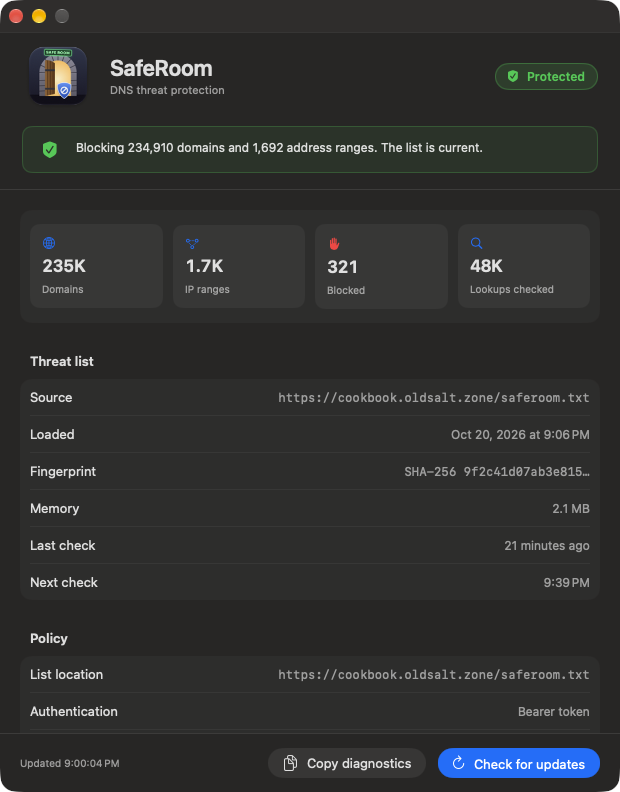

# SafeRoom

SafeRoom is a macOS system extension that blocks DNS lookups for domains on a threat intelligence list. It answers NXDOMAIN (the DNS "this name does not exist" reply) for each listed domain. All other queries go to the resolver that the Mac already uses.

SafeRoom works well with lists of up to about 3 million domains. A test with 10 million domains also worked, but each update then needs 44 seconds and over 1 GB of memory while it compiles. The whole list stays in memory as a compact hash table. [docs/performance.md](docs/performance.md) has the measurements.

An MDM (Jamf or any other) can deploy and configure SafeRoom. The policy sets where the list comes from: an HTTPS URL or a local file. On a Mac with no MDM, you can set up SafeRoom in the app.

The name comes from Dungeon Crawler Carl. In the dungeon, a safe room is the one place where nothing can attack you.

## Status

This project is in early development. The proxy blocks domains and address ranges, over UDP and TCP, and it logs each block with the app that asked. It downloads its list from an HTTPS URL with a bearer token, rejects suspect lists, and keeps the last good list on any failure. On a test Mac, a list of 250,000 domains uses 2.2 MB of memory, and a lookup takes about 140 nanoseconds.

The app window shows the extension's health, the list in use, and the policy, and `SafeRoom --jamf` reports health to Jamf inventory. Sample MDM profiles and a signed installer package are ready. Deployment through Jamf Pro and the client certificate download are not tested yet. The client certificate (mTLS) download is built but not tested.



The screenshot shows sample data (`-SampleStatus YES`, Debug builds only).

## Use SafeRoom without MDM

1. Install the SafeRoom package. It puts the app in `/Applications`, where a system extension must be.
2. Open SafeRoom. If macOS asks you to allow the system extension, open System Settings > General > Login Items & Extensions, and turn SafeRoom on.
3. In the SafeRoom window, click "Use the free cookbook list". To use another list, click "Choose another list…".
4. When macOS asks to add a proxy configuration, click Allow.

To change the list or the update interval, click "Change list…" in the Policy section. If the list blocks a site that you need, add its domain under "Never block". On a Mac that an MDM manages, the window is read-only.

## Free threat list

The [cookbook](https://cookbook.oldsalt.zone/) list is free for anyone to use with SafeRoom. It merges several open threat intelligence feeds into one list in the SafeRoom format, with about 235,000 domains and 1,700 address ranges. The list needs no token. On a Mac with no MDM, the app offers it at the first start. Under MDM, set these two keys in the policy:

```xml
<key>ListURL</key>
<string>https://cookbook.oldsalt.zone/list.txt</string>
<key>ListSHA256URL</key>
<string>https://cookbook.oldsalt.zone/list.txt.sha256</string>
```

The list comes with no warranty. Read the [sources and licenses](https://cookbook.oldsalt.zone/attribution.txt), and check the entries before you rely on the list.

## Documentation

- [docs/list-format.md](docs/list-format.md): the blocklist format.
- [docs/mdm.md](docs/mdm.md): the MDM policy keys and the update rules.
- [docs/mtls-okta.md](docs/mtls-okta.md): the client certificate download, and its open risks.
- [docs/threat-model.md](docs/threat-model.md): what SafeRoom stops, what it does not stop, and how it fails.
- [mdm/](mdm/): the MDM profiles and the Jamf extension attribute.

## Requirements

- macOS 15 or later.
- Xcode 27 and [XcodeGen](https://github.com/yonaskolb/XcodeGen).

## Build

```sh
make test      # SafeRoomCore unit tests. Needs no signing.
make open      # Generate SafeRoom.xcodeproj and open it in Xcode.
make release   # Archive, sign with Developer ID, notarize and staple.
make package   # Signed, notarized installer package for MDM.
make bench     # The list engine at several sizes (see docs/performance.md).
```

`make release` needs a Developer ID certificate, the Developer ID provisioning profiles, and a `notarytool` keychain profile. To build under your organization, change the two lines in `Config/Identity.xcconfig` and follow [docs/building.md](docs/building.md).

## License

Apache License 2.0. See [LICENSE](LICENSE).
